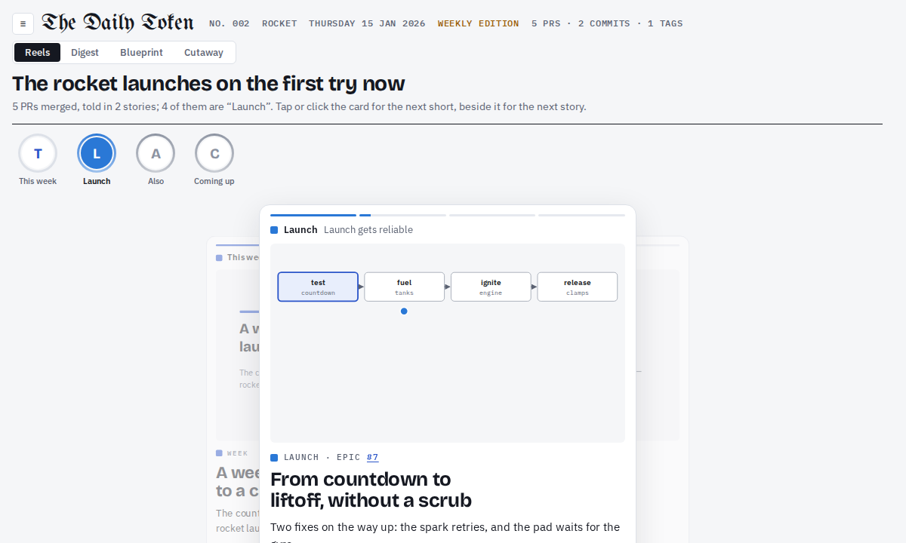

# The Daily Token

Agents open more PRs than anyone can follow. The Daily Token turns a day of merges into short animated reels and a plain-words digest, and checks every claim against the data.



## Quick start

You need [Bun](https://bun.sh) 1.3+ and the [Claude Code](https://docs.anthropic.com/en/docs/claude-code) CLI, logged in.

```sh
bunx daily-token preview                      # the made-up sample issue on :5173
bunx daily-token init my-digest               # asks for repos, time zone, cutoff, issue days
cd my-digest && export GH_TOKEN=...           # read-only token for those repos
bunx daily-token project cartographer         # proposes a map of the system
bunx daily-token project cartographer --accept   # keeps it
bunx daily-token run --date 2026-10-20        # make an issue
bunx daily-token preview
```

Not on npm yet: from a clone, `bun install && bun link`, then `bun link daily-token` in your digest folder.

## What you get

Each issue has four tabs:

- **Digest**: one thread of 6–12 s animated shorts per story, played like stories on a phone.
- **Ledger**: one card per PR, in plain words, with the technical detail under the hood.
- **Blueprint**: a map of the system, with the parts that changed today lit up.
- **Cutaway** (optional): a narrated 40–90 s tour of how one part of the system works.

On the weekly day, the issue also looks back at the week.

## How it works

```
collect ─▶ stories ─▶ reels ─▶ motion ─▶ check
GitHub     Writer     Director   Explainer
           ⇄ Editor   ⇄ Readers  ⇄ Viewer
```

Code collects the day from GitHub. Agents write; other agents review against rubrics, and the author revises until the review passes. `check` refuses any PR, count or quote that isn't in the collected data.

Your digest is its own repo, the **data root**: `project.json`, a map of the system, and one folder of JSON per issue. Every publish renders every issue again from its JSON, so a fix to the look reaches the whole archive.

## Deploy

| Where | What it takes |
|---|---|
| Your machine | nothing: `preview` |
| A GitHub Action | the workflow `init` writes: makes the issue every issue day and commits it to the data repo |
| A bucket and a site | any S3-compatible bucket, then `daily-token serve` anywhere, or the optional Cloudflare Worker; readers sign in with GitHub |

See [docs/deploy.md](docs/deploy.md).

## Configuration

| Setting | Where | Default |
|---|---|---|
| `ANTHROPIC_API_KEY` | env (CI only) | your Claude login locally |
| `GH_TOKEN` | env | none: a read-only token for the repos |
| `DIGEST_TZ`, `CUTOFF` | env | `UTC`, `00:00`: when the day ends |
| `days` | `project.json` | every day: the days an issue comes out |
| `weekly` | `project.json` | none: the day an issue also recaps the week, e.g. `"fri"` |
| `pipeline` | `project.json` | rounds, budget and reviewers per stage; see [docs/pipeline.md](docs/pipeline.md) |

## Documentation

- [Commands](docs/commands.md): every command and its flags
- [The pipeline](docs/pipeline.md): what is collected, the agents and the review loop
- [An issue](docs/issue.md): the files in a data root, the tabs, and formats
- [Templates](docs/templates.md): reel templates, scenes and animation marks
- [The Cutaway](docs/cutaway.md): the narrated tour and what it needs (ffmpeg, Node, Chrome)
- [Deploy](docs/deploy.md): workflows, the bucket, `serve`, the Cloudflare Worker

## License

[Apache-2.0](LICENSE). The starter files `init` copies into your data repo are [MIT](starter/LICENSE).
