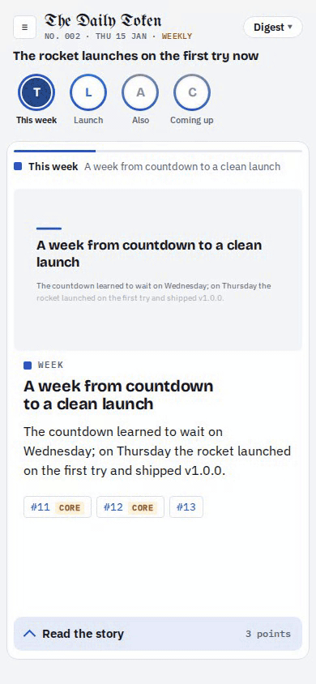

# The Daily Token

A daily digest of what landed in your repos: agents write it in plain words, cut it into short animated reels, and every claim is checked against the data.

<p align="center">
  
</p>

## What you get

Agents open more PRs than anyone can follow. Each issue turns a day of merges into four tabs:

- **Digest**: one thread of 6–12 s animated shorts per story, played like stories on a phone. Tap for the next one.
- **Ledger**: one card per PR, in plain words, with the technical detail under the hood.
- **Blueprint**: a map of the system, with the parts that changed today lit up.
- **Cutaway** (optional): a narrated 40–90 s tour of how one part of the system works.

On the weekly day, the issue also looks back at the week.

## How it works

```
collect ─▶ stories ─▶ reels ─▶ motion ─▶ check ─▶ render ─▶ publish
GitHub     Writer     Director   Explainer
           ⇄ Editor   ⇄ Readers  ⇄ Viewer
```

1. Code collects the day from GitHub.
2. Agents write the stories and reels. Other agents review them against rubrics, and the author revises until the review passes.
3. `check` refuses any PR, count or quote that isn't in the collected data.
4. `render` builds the pages. `publish` is optional.

Your digest is its own repo, the **data root**: `project.json`, a map of the system, and one folder of JSON per issue. Every publish renders every issue again from its JSON, so a fix to the look reaches the whole archive.

## Get started

The npm package isn't published yet. Until it is, run the engine from a checkout: clone this repo, `bun install`, and type `bun src/cli.ts` wherever this README says `daily-token`. Point it at your digest with `--root DIR` or `DATA_DIR`. Or run `bun link` in the clone and `bun link daily-token` in your digest folder to get the `daily-token` command.

```sh
daily-token preview                       # the made-up sample issue on :5173
daily-token init my-digest                # asks about the project, then offers to make its GitHub repo and set its keys
cd my-digest && export GH_TOKEN=...       # read-only token for those repos
daily-token project cartographer          # proposes a map of the system
daily-token project cartographer --accept # keeps it
daily-token project brief --accept        # optional: names and terms from the repos' docs
daily-token run --date 2026-10-20         # make an issue
daily-token preview                       # read it on :5173
```

`project brief` writes a proposal first; run it without `--accept` to read or edit it before you keep it.

`init` asks for the repos, time zone, cutoff, issue days, stories, the Cutaway, who may read and the name on the share cover. In a terminal it then offers, step by step and each skippable, to make the digest's private repo on GitHub, set its Actions secrets and variables with `gh` (it says where each key comes from), and put the site online. `init --dry-run` prints those commands, values hidden, and runs none.

Hosting is optional. To share issues, `daily-token github-app` makes the GitHub App readers sign in with, and `daily-token deploy` puts the bucket and the site on Cloudflare. Readers sign in with GitHub, and whoever can see every one of the project's repos may read it. `init` also writes a GitHub Action that makes the issue every issue day. Any S3-compatible bucket with `daily-token serve` works too. See [docs/deploy.md](docs/deploy.md).

## Requirements and cost

- [Bun](https://bun.sh) 1.3+.
- The [Claude Code](https://docs.anthropic.com/en/docs/claude-code) CLI, logged in.
- Optional: a Cloudflare account to host the site.

The agents run on your Claude login. Real issues have cost about $2–12 of model time each.

## Configuration

| Setting | Where | Default |
|---|---|---|
| `ANTHROPIC_API_KEY` | env (CI only) | your Claude login locally |
| `GH_TOKEN` | env | none: a read-only token for the repos |
| `DIGEST_TZ`, `CUTOFF` | env | `UTC`, `00:00`: when the day ends |
| `days` | `project.json` | every day: the days an issue comes out |
| `weekly` | `project.json` | none: the day an issue also recaps the week, e.g. `"fri"` |
| `pipeline` | `project.json` | rounds, budget and reviewers per stage, and the most stories an issue may have (`stories.maxStories`, 6); see [docs/pipeline.md](docs/pipeline.md) |

## Documentation

- [Commands](docs/commands.md): every command and its flags
- [The pipeline](docs/pipeline.md): what is collected, the agents and the review loop
- [An issue](docs/issue.md): the files in a data root, the tabs, and formats
- [Templates](docs/templates.md): reel templates, scenes and animation marks
- [The Cutaway](docs/cutaway.md): the narrated tour and what it needs (ffmpeg, Node, Chrome)
- [Deploy](docs/deploy.md): workflows, the bucket, `serve`, the Cloudflare Worker, sign-in

## License

[Apache-2.0](LICENSE). The starter files `init` copies into your data repo are [MIT](starter/LICENSE).
